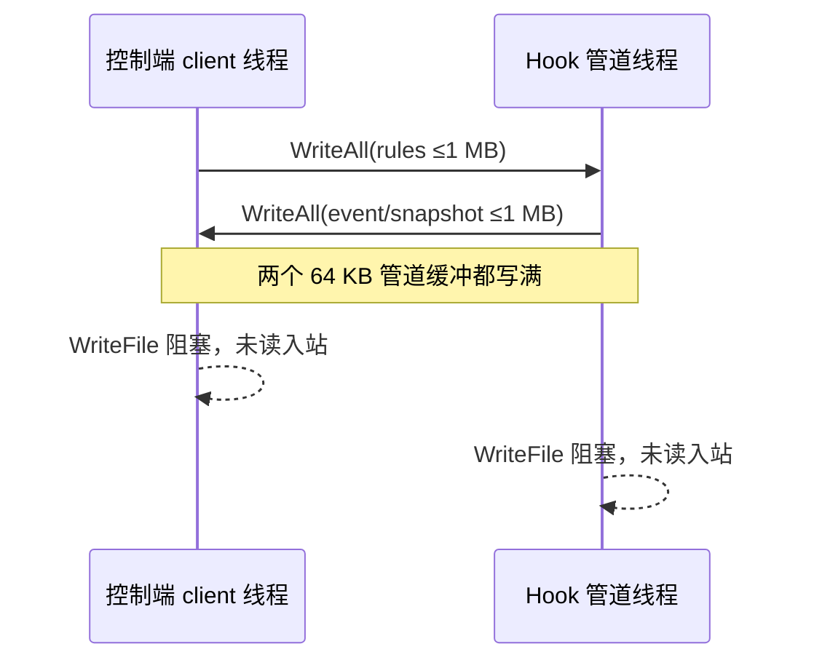

# ClipboardProtector 代码审查记录（2026-10-31）

- 审查对象：当前工作区源码。`HEAD` 为 `8699083`，另含未提交修改 `hookdll/hookmain.cpp`（映射视图生命周期、worker 重启、`g_workerStartCs`）。
- 审查重点：死锁/卡死、无界等待、线程与句柄生命周期、Detours 事务、跨进程管道、UI 线程阻塞。
- 审查方式：静态审查，交叉核对 `UnhookWindowsHookEx`、`CancelSynchronousIo` 的官方语义和 `third_party/Detours/src/detours.cpp` 的事务实现。
- 结论：发现 2 条 P0 级“卡死/永久失效”路径、1 条由未提交改动引入的 P0/P1 级双 worker 竞态，以及多条 P1/P2 级无界等待和 UI 阻塞。
- 注意：本文是静态审查记录，不是运行验收通过证明。竞态类问题仍需定向 smoke/压力注入复现。

## 严重度定义

| 级别 | 含义 |
|---|---|
| P0 | 可导致永久死锁、宿主进程剪贴板永久失效，或保护无法停止/卸载。 |
| P1 | 可导致退出/切换保护长时间卡住，或存在明确的无界等待、UAF、静默失效。 |
| P2 | 可导致短暂 UI 冻结、资源泄漏、竞态崩溃，或显著的用户感知卡顿。 |

## 一、问题清单

| 级别 | 位置 | 问题摘要 |
|---|---|---|
| P2（复审后降级） | `hookdll/privateclip.cpp:30,97,119,486-494`；`hookdll/hookmain.cpp:2134,2322` | 私有剪贴板失败后永久隔离是文档写明的 fail-closed 设计；`CanDetach` 永久 false 导致该目标无法卸载、目标剪贴板需重启应用恢复。剩余问题：retained 目标没有上报 UI；`CanDetach` 的 Ready 取消存在一个跨进程窄竞态。 |
| P1（复审后降级） | `app/pipeserver.cpp:1079-1083,1401`；`hookdll/hookmain.cpp:1109-1110,1280-1334,2196-2251`；`common/winutil.cpp:72-82` | 控制端与 Hook 端都用同步 `WriteFile`，管道缓冲各 64 KB；双方都先写完再读。只有规则帧 >64 KB 且 Hook 同时写 >64 KB（大快照或积压事件）才会死锁；默认配置少见，切换保护通常可恢复（StopClients 超时保留连接时不保证）。 |
| 已修复（复审） | `hookdll/hookmain.cpp:3032-3110,2147-2167` | 复审确认：`g_workerRunning` 在 `CreateThread` 前持 `g_workerStartCs` 置位，`PrepareWorkerExit` 同锁发布；双 worker 主路径已关闭。 |
| P1 | `app/pipeserver.cpp:302-310,1667-1702,1127-1135` | 析构/`StopClients(true)` 只 `CancelSynchronousIo` 一次就 `WaitForSingleObject(INFINITE)`；监听线程可能刚进入 `ConnectNamedPipe`，或在两次 `WriteFile` 之间，取消不到，退出永久挂起。 |
| P1 | `app/coveragemonitor.cpp:139,151-159,164-171,368-410`；`common/remotehook.cpp:225` | `Pause` 只等 3 s，但 `RemoteHookStart/Release` 可等 5 s、`Run32BitHelper` 可等 20 s；超时后 `thread_` 仍非空，`Start()` 直接返回 true，覆盖巡检静默停止；析构时线程仍可能访问 `this`/`g_server`。 |
| P1 | `app/hookthread.cpp:60,64,75,79`；`app/injector.cpp:438` | `HookThread::Install/Remove` 对完成事件和线程使用 `INFINITE` 等待，保护开关/退出没有超时。 |
| P1 | `app/mainwnd.cpp:888,895,925,927,941`；`app/autostart.cpp:121-138` | UI 线程同步执行 `schtasks`：查询 10 s + 设置 10 s + 回滚 10 s；`JoinAutostartQuery` 本身无超时。期间无法处理确认窗口，被注入应用的剪贴板确认会阻塞到 60 s 超时。 |
| P1 | `app/hookthread.cpp:112-117`；`hookdll/hookmain.cpp:2132,3131-3135` | `UnhookWindowsHookEx` 返回后目标线程仍可能在 `GetMsgProc`；worker 随后释放模块引用，DllMain 删除临界区，存在卸载竞态。 |
| P2 | `hookdll/hookmain.cpp:222-234,237-289,2999,207-218,466,2366` | 未提交的 `g_retiredViews`、`g_sourceMapping`、`g_cryptoMapping` 无锁；host 线程与 worker 线程可并发 Close/Open；容量 8 后视图泄漏；重启时重写 `g_processPathLower/NameLower`，而 hooks 仍安装并在其他线程读。 |
| P2 | `app/pipeserver.cpp:598-710`；`app/mainloop.cpp:565-585` | `Stop()` 最坏 5 s ACK + 5 s listener + 2 s cancel + 3 s clients ≈ 15 s；退出路径再叠加 coverage 3 s、injector 10 s、release 10 s，可达 30 s+，无进度提示。 |
| P2 | `app/mainwnd.cpp:2282-2350` | CSV 导出在 UI 线程同步写文件（日志上限 32 MB），慢盘/网络路径会让 UI 长时间冻结。 |
| P2 | `app/privateclipboard.cpp:168-171,214-237` | `WM_DESTROY`/析构在 UI 线程 `join` 私有剪贴板 worker；worker 可能处于 UIAutomation、`SendInput` 或 hook pump 中，取消检查只在循环点，缺少超时。 |

## 二、私有剪贴板隔离（复审后降级为 P2，设计行为）

复审修正：`doc/manual.md:103` 已写明这是有意的 fail-closed 设计——操作未完整结束后保留隔离，恢复普通复制粘贴需要重启目标应用。因此不再按 P0 计；本节保留为行为/UX 记录。之前“`created` 状态也会被隔离”的结论撤回，理由见下。

### 证据链

1. `Quarantine()` 置 `quarantined = true`（`hookdll/privateclip.cpp:119`），全文件没有任何复位点。
2. `ReleaseSession()` 执行 `gate.store(quarantined)`（`hookdll/privateclip.cpp:97`），于是失败后 `gate` 永久为 true。
3. `Blocking()` 返回 true（`hookdll/privateclip.cpp:465`），而 `Inside()` 因 `session == nullptr` 返回 false；`Open/Get/Set/Empty/Close/Available/Enum/Count/Priority/Owner/OpenWindow` 全部走拒绝路径，目标进程的剪贴板被永久拒绝。
4. `CanDetach()` 返回 `!gate.load() && liveObjects.load() == 0`（`hookdll/privateclip.cpp:486-494`），永久 false。
5. `RemoveHooks()` 因此直接返回 false（`hookdll/hookmain.cpp:2134`），worker 发送 `kIpcShutdownRetained` 后退出（`hookdll/hookmain.cpp:2322`）。
6. 控制器 `PipeServer::Stop` 看到 `shutdownRetained` 只用于结束等待（`app/pipeserver.cpp:1324`），没有上报 UI；`Injector::Remove()` 只负责卸载 WH_GETMESSAGE 钩子并返回成功。结果：UI 显示保护已关闭，但目标进程内由私有剪贴板安装的 Detours 仍在，剪贴板继续被拒绝。

### 复审修正：`created` 状态说法不成立

`Arm()` 从设置 `session` 到 CAS 成 `kPrivateReady` 或执行 `ReleaseSession`，全程持有 `Lock`（`hookdll/privateclip.cpp:504-546`）；`CanDetach()` 也在同一 worker 线程执行并先取 `Lock`（`:486-494`；`Arm` 调用点 `hookdll/hookmain.cpp:1687`，`CanDetach` 调用点 `:2134`）。因此 `CanDetach()` 看不到 `kPrivateCreated`；`kPrivateReady` 的取消由 CAS 处理。之前“还没发送输入的 created 会话也会被隔离”的结论撤回。

仍存在一个跨进程窄竞态：`CanDetach()` 的 `Poll()` 与 CAS 之间，控制器可在 `Session::~Session` 中把 `Ready` 改为 `CancelledBeforeInput`；CAS 期望 `Ready` 会失败，随后 `if(session) Quarantine(...)` 会把本应安全释放的会话隔离。建议 CAS 失败后重读状态，若为 `kPrivateCancelledBeforeInput` 则 `ReleaseSession()`，而不是 `Quarantine()`。

### 影响

- 按设计，目标进程普通复制/粘贴会保持拒绝，直到重启目标应用。
- 停止保护、退出程序无法干净卸载该进程内的钩子；这是设计取舍。
- 控制器没有把“哪些 PID 仍被隔离”呈现给用户，只留下 trace 中的 `server.client.retained`；这是本次唯一需要补的 UX/诊断项。

### 修复建议

- 保留现有 fail-closed 设计，不必为了可卸载而放宽隔离。
- 控制器把 `shutdownRetained` 的 PID 上报 UI，并说明需要重启这些目标进程，而不是只显示“保护已关闭”。
- `CanDetach()` 的 CAS 失败路径重读状态，避免把并发取消的 `CancelledBeforeInput` 会话误隔离。
- 检查 `liveObjects != 0` 的路径：目标若泄漏 OLE `IDataObject` 引用，也会让 `CanDetach` 持续 false；这属于额外保留原因，建议在 trace 中区分。

## 三、双向同步写死锁（复审后降级为 P1）

复审修正：这不是默认配置下容易触发的 P0。服务端每轮只有完整状态帧可能很大；确认响应、私有请求和 shutdown 帧都很小。死锁需要“规则帧 > 约 64 KB”且“Hook 端同时写 > 约 64 KB（大快照或积压事件）”两个条件同时成立。发生后 Hook 仍按旧规则拦截，确认请求按超时策略处理，切换保护通常可恢复；但若 `StopClients` 超时保留了连接，则不一定能自动恢复，因此按 P1 计。

### 机制

- 服务端每实例缓冲区 64 KB（`app/pipeserver.cpp:1079-1083`）。
- 服务端先连续写 `begin/rules/pause/settings`，其中规则快照上限约 1 MB（`app/pipeserver.cpp:1401`，`common/rules.h:76-99`）。
- Hook 端先连续写事件/确认/快照，快照上限 1 MB（`hookdll/hookmain.cpp:1109-1110,1280-1334`，`common/ipc.h:19-21`）。
- 两端在写之前都不读对向管道；`WriteAll` 无超时（`common/winutil.cpp:72-82`）。



### 触发条件

不需要恶意进程，但比默认配置窄：

- 控制端广播一套大规则集（约 64 KB 以上，通常数百条规则或有超长 pattern），同时 Hook 队列里有一个大快照事件或超过 64 KB 的积压事件。
- 快照默认关闭；开启图片/文件列表快照后，1 MB 快照事件才容易满足 Hook 侧条件。
- 协议允许 `sourcePath` 长达 32768 个 `wchar_t`，因此超长确认请求也能让 Hook 侧超过 64 KB，但真实路径通常远小于此，不是常见触发。

### 影响

- IPC 死锁：Hook worker 不再读规则/确认响应，事件丢失，新的确认请求无法送出，已有确认请求只能等超时。
- Hook 仍按旧规则快照拦截，因此不是“保护完全失效”；是规则热更新、事件上报和确认交互失效。
- 控制器在 `Stop()` 中取消服务端写通常可打破死锁；若 `StopClients` 超时保留了连接，则停止/重启一次保护不一定能自动恢复，可能需要退出目标/控制器。
- 目标应用若命中确认规则，其剪贴板调用会阻塞到 `timeoutMs`（最大 60 s）。

### 修复建议

同意只改控制端、降低注入 DLL 风险。关键是让服务端在写状态帧挂起期间继续读入站，而不是只把 `WriteAll` 换成 overlapped 后仍在同一线程等待写完成：

- 服务端为状态帧使用 overlapped 写，挂起期间继续 `PeekNamedPipe`/`ReadFile`，完成后再发下一帧；或使用独立 writer 线程 + 有界队列，读线程始终运行。
- 至少覆盖 `begin/rules/pause/settings` 这条大状态路径；确认响应、私有请求和 shutdown 帧很小，可以后续统一。
- 如果单线程实现，需要事件循环同时等待 overlapped 写完成事件和入站可读，不能写挂起后阻塞等待。
- 不建议只把单帧限制在 64 KB 以下：规则总量仍可能超过 64 KB，分帧后仍会遇到同一环。

## 四、双 worker 竞态（复审确认已修复）

复审确认：当前代码已在 `CreateThread` 前持 `g_workerStartCs` 置 `g_workerRunning=1`，`PrepareWorkerExit` 在同一锁内发布两个标志，主路径的双 worker 已关闭。以下保留原始分析，便于对照。

### 机制

`EnsureWorker` 的重启条件（`hookdll/hookmain.cpp:2970-3002`）：

```cpp
if (explicitStart &&
    g_workerRunning.load(std::memory_order_acquire) == 0 &&
    g_workerStarted.load(std::memory_order_acquire)) {
    ... reset / CloseControllerSignals() ...
}
```

但新 worker 直到 `PipeThreadBody()` 第一行才置 `g_workerRunning = 1`（`hookdll/hookmain.cpp:2154-2156`），而线程是在 `CreateThread` 后才开始执行的（`hookdll/hookmain.cpp:3042`）。

可复现顺序：

1. 目标线程先处理一条普通消息 → `GetMsgProc(false)` → 创建 worker T，但 T 还没被调度，`g_workerRunning` 仍为 0。
2. 目标线程紧接着处理注入器投递的 start message → `GetMsgProc(true)` → 条件成立 → 清空队列、关闭 controller 句柄/映射、创建第二个 worker T2。
3. T 和 T2 同时进入 `PipeThreadBody`，共享 `g_pipe`、`g_queue`、`g_controlInput`、`g_confirmationQueue`、`g_stopEvent` 等全局状态；一个连接 pipe，另一个可能连到第二个实例，互相覆盖/关闭句柄。
4. 两个 worker 都可能执行 Detours 事务/退出路径；一个在另一个仍运行时把 `g_workerRunning` 置 0，触发下一轮 reset，进一步放大。

### 影响

- 至少是保护失效、事件/确认错乱、重复/竞争 Detours。
- 更坏情况下，一个 worker 的 `CloseControllerSignals()` 会关闭另一个仍在使用的映射/事件；DllMain 在卸载时删除仍在使用的临界区，导致宿主进程崩溃或卸载卡死。
- 该竞态还会放大 P2 中的 `g_retiredViews`/`g_sourceMapping` 数据竞争，以及 `PrepareProcessIdentity` 重写 `g_processPathLower/NameLower` 时与 hooks 读线程的 `std::wstring` 竞态。

### 修复建议

- 用单一 `WorkerState` 状态机（`stopped/starting/running/exiting`）。
- 在 `CreateThread` 之前、持 `g_workerStartCs` 置 `running`；只有 worker 真正退出并发布 terminal 标志后才允许 reset。
- 用 `compare_exchange` 保证只有一个线程执行 reset。
- 所有 mapping/句柄的打开关闭只允许 worker 线程做，或统一加锁。
- 不要在 hooks 仍安装时重写 `g_processPathLower/NameLower`；进程身份应在首次安装 hooks 前计算并保持不变。

## 五、P1：无界等待与长时间卡住

### 5.1 PipeServer 析构/StopClients

- `PipeServer::~PipeServer()`：`CancelSynchronousIo(listenThread_)` 后 `WaitForSingleObject(listenThread_, INFINITE)`（`app/pipeserver.cpp:302-310`）。
- `StopClients(true)`：一次 `CancelSynchronousIo` 后 `WaitForSingleObject(ctx->thread, INFINITE)`（`app/pipeserver.cpp:1667-1702`）。
- 监听线程的 `ConnectNamedPipe` 在 stop 检查之后调用（`app/pipeserver.cpp:1127-1135`）；Stop 的 wake `CreateFile` 只做一次（`app/pipeserver.cpp:649-654`）。如果监听线程在 wake 之后才创建新实例并进入 `ConnectNamedPipe`，它会一直阻塞。
- `CancelSynchronousIo` 只取消调用瞬间已存在的同步 I/O；如果线程在两次 `WriteFile` 之间，取消会返回 `ERROR_NOT_FOUND`，随后线程再次写就可能永久阻塞，而析构已经进入 `INFINITE`。

后果：进程退出永久挂起；`Stop()` 超时留下 `listenThread_` 后，`Start()` 因 `if (listenThread_) return false;` 永远无法重新开启保护。

建议：重复“取消/唤醒 + 有界等待”，超时后宁可泄漏线程/句柄也不要挂死退出；关闭 pipe 句柄以解除写阻塞；优先改为 overlapped I/O。

### 5.2 CoverageMonitor

- `Start()` 在 `thread_` 非空时直接返回 true（`app/coveragemonitor.cpp:139`）。
- `Pause()` 只等 3 s（`:151-159`），但 `RemoteHookStart/Release` 单次可等 5 s（`common/remotehook.cpp:225`），`Run32BitHelper` 可等 20 s（`app/coveragemonitor.cpp:402`）。
- 超时后 `thread_` 仍非空；`Resume()` 等 2 s 后直接返回 true，不创建新线程（`:164-171`）。
- `RemoveHooksAndRestartServer`/`StopProtectionForExit` 忽略 `Pause()` 的返回值（`app/mainloop.cpp:142,174,569`）；`ReleaseRetainedReferences()`/`Clear()` 又因 `thread_` 非空直接返回。

后果：保护切换/退出后覆盖巡检静默停止；全局注入“看似开启”但不再巡检；`~CoverageMonitor()` 在超时后关闭 `stopEvent_`，线程仍可能使用它；`g_coverage` 析构后线程仍可能访问 `this` 和 `g_server`，退出时 UAF。

建议：`Pause` 的等待上限必须覆盖最长远程调用，或让远程调用可取消；超时后不要保留 `thread_`，应标记 monitor 不可用并安全重建；析构必须 join 或 detach 到安全点，不能销毁仍被线程使用的对象。

### 5.3 HookThread 的 INFINITE 等待

- `Install()` 等 `state_->completed` 为 `INFINITE`（`app/hookthread.cpp:60`）。
- `Remove()` 等 `state_->completed`/`state_->thread` 为 `INFINITE`（`app/hookthread.cpp:75,79`）。
- `Injector::Remove()` 先调用 `hook_.Remove()`（`app/injector.cpp:438`），再等 helper 进程。

后果：如果 hook owner 线程卡在 `SetWindowsHookExW`、`DispatchMessageW` 或 `UnhookWindowsHookEx`，保护开关/退出会在 worker 上永久等待，UI 显示 “Changing protection” 后不再有结果。

建议：改成有界等待 + 明确错误；超时后保留模块/句柄并 fail-open，不要挂死控制器；同时给 UI 一个可取消/可诊断的状态。

### 5.4 UI 线程同步 schtasks

`kCmdSettings` 在 UI 线程上：

- `JoinAutostartQuery()`（`app/mainwnd.cpp:888`，无超时，`app/mainwnd.cpp:559-562`）。
- `QueryAutostart()`（`:895`）内部 `RunSchtasks` 最长 10 s（`app/autostart.cpp:121-138`）。
- `SetAutostart()`（`:925`）最长 10 s；失败回滚 `RestoreAutostartState()` 再 10 s（`:927,941`）。

后果：打开/保存设置时 UI 冻结数秒到数十秒；期间无法处理 `kMsgConfirmation`，被注入应用的确认规则调用会一直阻塞到 60 s 超时，表现为目标应用卡死。

建议：把 `schtasks` 查询/设置移到 worker；设置对话框只使用已有状态；UI 阻塞期间确认请求应快速 fail-open 或由独立线程处理。

### 5.5 Hook DLL 卸载竞态

- `HookThread::Run` 在 `UnhookWindowsHookEx` 成功后 `SetEvent(completed)` 并退出（`app/hookthread.cpp:112-117`）。
- `WorkerExit` 之后 `FreeLibraryAndExitThread`（`hookdll/hookmain.cpp:2132`）。
- `DllMain(DLL_PROCESS_DETACH)` 在 `g_workerRunning==0 && !g_hooksInstalled` 时删除临界区（`hookdll/hookmain.cpp:3131-3135`）。

MS 文档明确：`UnhookWindowsHookEx` 返回后，hook procedure 仍可能正在另一个线程中执行。此时若目标 DLL 被卸载、DllMain 删除临界区，在途 `GetMsgProc` 会进入已删除的临界区或已卸载代码，导致目标进程崩溃/死锁。`HookThread` 只等 hook owner 线程，不等目标回调。

建议：不要立即释放模块；增加 `GetMsgProc` 在途计数并等待归零，或保持 DLL 常驻；DllMain 不应删除可能仍被回调使用的临界区。

## 六、P2：竞态、泄漏与延迟

### 6.1 未提交的映射视图/句柄生命周期

`g_retiredViews`、`g_retiredViewsCount`、`g_sourceMapping`、`g_cryptoMapping` 都是普通全局变量（`hookdll/hookmain.cpp:222-234,237-289`）：

- `EnsureWorker` 的 reset 在 host 线程执行 `CloseControllerSignals()`（`:2999`），worker 线程可能在 `BindPipeServer`/`OpenSourceMapping` 中并发执行 Close/Open。
- 两个线程可能同时读取同一个非空 `g_sourceMapping` 并各 `CloseHandle` 一次，第二次可能关闭已被复用的句柄。
- `g_retiredViews` 容量固定 8；hooks 仍安装时每次重启会 retire 两个视图，超过 4 次后旧视图永不 `UnmapViewOfFile`，形成泄漏。
- reset 路径在 hooks 仍安装时调用 `CloseControllerSignals()`，会关闭 `g_stopEvent`；在途 `ConfirmAccess` 可能正在 `WaitForMultipleObjects` 等这个句柄。

建议：映射状态只允许 worker 线程修改；retired 视图用互斥量或原子容器管理并取消固定 8 的上限；`g_stopEvent` 等生命周期句柄在完整 rundown 前不要关闭。

### 6.2 Stop 延迟

`PipeServer::Stop()` 最坏：

- 5 s 等 shutdown ACK（`app/pipeserver.cpp:660-680`）。
- 5 s 等 listener，再 2 s 等取消（`:695-704`）。
- 3 s 等 client 线程（`:709`，`StopClients(false)` 内部 3 s）。

退出路径 `StopProtectionForExit` 还叠加 `CoverageMonitor::Pause` 3 s、`Injector::Remove` helper 5+5 s、`ReleaseRetainedReferences` 10 s（`app/mainloop.cpp:565-585`）。最坏可达 30 s+，且没有进度提示，用户会认为卡死。

建议：Stop 先 cancel/wake 再短等；把长等待放到后台并显示进度；给用户可取消的退出状态。

### 6.3 CSV 导出

`MainWindow::ExportCsv()` 在 UI 线程逐字段同步 `WriteFile`（`app/mainwnd.cpp:2282-2350`），日志上限 32 MB。慢盘或网络路径会让 UI 长时间冻结；期间确认窗口无法处理，放大目标应用阻塞。

建议：导出放到 worker，UI 只显示进度/完成/失败。

## 七、已检查且未发现明显问题的点

- `PipeServer` 的锁顺序：`confirmationsMu_` → `clientsMu_` → `responsesMu_` 没有发现反向嵌套；`ReapClients` 的 `stateMu_`/`clientsMu_` 是顺序获取，不是嵌套。
- `privateclip` 的 SRW 锁没有发现同线程递归获取；`ReleaseSession` 在锁内调用 `UnhookWindowsHookEx`，该 API 不会等待在途回调，因此不构成锁等待死锁（但卸载竞态仍见 5.5）。
- Detours 事务本身用 `s_nPendingThreadId` 拒绝并发事务，不会因为第二个事务阻塞；双 worker 的危害主要在共享状态和退出路径，而不是 Detours 锁本身。
- 规则匹配有 `kMaxRegexWork`/`kMaxRegexWorkPerRule` 上限，未发现无界回溯。
- 事件队列、日志队列、确认队列都有容量上限；钩子路径的规则锁使用 `TryEnterCriticalSection`，未发现钩子线程无限等待规则锁。

## 八、建议修复顺序

1. 私有剪贴板：保留 fail-closed 设计；补 retained PID 的 UI 提示；修 `CanDetach` 并发取消的窄竞态（原 P0-1 降级 P2）。
2. 改造管道读写：只改控制端，overlapped 写挂起期间继续读入站，或独立 writer 线程；禁止“写大帧时无人读”（P1）。
3. worker 状态机：复审确认双 worker 主路径已修复；保留回归，mapping/句柄仍只归 worker。
4. 消除无界等待：`PipeServer` 析构、`StopClients`、`HookThread`、`JoinAutostartQuery`。
5. 修复 CoverageMonitor 的超时/重启/析构顺序。
6. 把 `schtasks`、CSV 导出移出 UI 线程；确认请求在 UI 阻塞时快速 fail-open。
7. 增加 GetMsgProc 在途计数或保持 DLL 常驻，消除卸载竞态。
8. 给 `g_retiredViews`/mapping 句柄加同步，取消固定容量泄漏。

## 九、验证状态与限制

- 本次为静态审查，未运行修改后的二进制，未做注入压力/并发大帧测试。
- 建议为管道死锁（P1）增加定向 smoke：同时发送大于 64 KB 的规则快照和大于 64 KB 的快照事件，确认不会双方阻塞。
- 双 worker 已修复；保留 `ClipHookLifecycleForTest` 回归，确认 start message 不会创建第二个 worker。
- 建议为私有剪贴板增加回归：`CanDetach` 的 Poll/CAS 与控制器 `Session::~Session` 并发取消时，`Ready` 应释放而不是误入 `Quarantine`；永久隔离本身按文档设计保留，并补 retained PID 的 UI 提示。

## 十、修改后复审（2026-10-31，工作区 18 个文件变更）

复审对象为当前工作区 `git diff`（18 个文件，+422/-191），含 `hookdll/hookmain.cpp`、`hookdll/privateclip.cpp`、`app/*`、`common/*`。本次先做静态复审，随后用 Visual Studio 18 2026 + CMake 4.3.1 完成 x64/x86 Release 编译：`BUILD_TESTING=ON`、`CLIP_NO_ELEVATE=ON`，两个架构均 `--clean-first` 全量重建，无 warning/error。产物在 `build/verify-vs18/x64/bin/Release` 与 `build/verify-vs18/x86/bin/Release`；未运行测试。

### 10.1 之前问题状态

| 之前问题 | 状态 | 证据/说明 |
|---|---|---|
| 私有剪贴板永久隔离（原 P0-1） | **降级 P2，设计行为** | 永久隔离是 `doc/manual.md:103` 写明的 fail-closed 设计，`CanDetach` 永久 false 与设计目标一致，不应按 P0 计。`created` 状态不可见：`Arm` 从设置 session 到 CAS/Release 全程持 `Lock`（`hookdll/privateclip.cpp:504-546`），`CanDetach` 同 worker 线程并先取 `Lock`（`:486-494`），之前的 created 结论撤回。剩余：retained PID 未上报 UI；`CanDetach` 的 Poll/CAS 之间存在并发取消被误 `Quarantine` 的窄竞态。 |
| 管道双向阻塞写死锁（原 P0-2） | **降级 P1，机制未修复** | 两端仍同步 `WriteAll`；服务端先写状态后读（`app/pipeserver.cpp:1409`），Hook 先写事件后读（`hookdll/hookmain.cpp:1150,1320`）。需规则帧 >64 KB 且 Hook 同时写 >64 KB（大快照/积压事件）才触发；默认配置少见。Hook 仍按旧规则拦截，确认请求按超时处理，切换保护通常可恢复（StopClients 超时保留连接时不保证）。修复建议只改控制端：overlapped 写挂起期间继续读入站，或独立 writer 线程。 |
| P0-3 双 worker 竞态 | **已修复（主路径）** | `EnsureWorker` 在 `CreateThread` 前、持 `g_workerStartCs` 置 `g_workerRunning=1`（`hookdll/hookmain.cpp:3106`）；`PrepareWorkerExit` 在同一锁内发布 `g_workerStarted/g_workerRunning`（`:2147-2167`）。保留路径仍直接 `g_workerRunning.store(0)`（`:2343`），但该线程之后不再访问共享状态，风险低。 |
| P1 PipeServer 析构/StopClients 无界等待 | **未修复** | `app/pipeserver.cpp:310-318,703-717,1705` 仍是单次 `CancelSynchronousIo` 后 `INFINITE`。 |
| P1 CoverageMonitor 超时/重启 | **部分修复** | 新增 `allowLoad`/`retainedSince`（`app/coveragemonitor.cpp:360-363`），减少冻结目标里重复远程 `LoadLibrary`。但 `Pause` 仍只等 3 s（`:151-159`），`Start()` 在 `thread_` 非空时仍直接 true（`:139`），`Resume()` 2 s 超时仍返回 true（`:164-171`），析构仍关闭 `stopEvent_`（`:87-90`）。 |
| P1 HookThread `INFINITE` | **未修复** | `app/hookthread.cpp:60,64,75,79` 未改。 |
| P1 UI 线程 schtasks/CSV | **未修复** | `app/mainwnd.cpp:889,896,926,928,942` 仍在 UI 线程同步查询/设置/回滚；`ExportCsv` 仍在 UI 线程写文件（`:2294`）。 |
| P1 Hook DLL 卸载竞态 | **部分修复** | `Hooked_*` 把计数移到任何外部调用之前（`hookdll/hookmain.cpp:2557-2560` 等）；新增 `g_activePrivateCalls` 并纳入模块释放检查（`:2085-2090`）。但 `GetMsgProc` 仍未计数，`DllMain` 仍删除临界区（`:3193-3201`），`HookThread::Remove` 仍在 `UnhookWindowsHookEx` 后释放模块。 |
| P2 `g_retiredViews`/mapping 竞态 | **部分修复** | 新状态机基本串行化了 mapping 的 Open/Close；但 `g_retiredViews` 仍固定 8 个槽（`hookdll/hookmain.cpp:232-244`），超过后新视图直接泄漏；`g_sourceMapping/g_cryptoMapping` 仍无显式锁。 |
| P2 Stop 延迟 | **未修复** | `app/pipeserver.cpp:660-717` 的 5 s ACK + 5 s listener + 2 s cancel + 3 s clients 未改；`app/mainloop.cpp:565-585` 的叠加等待未改。 |
| P2 CSV 导出 UI 阻塞 | **未修复** | 仅增加 `FNERR_BUFFERTOOSMALL` 提示（`app/mainwnd.cpp:2303-2307`），同步写文件未改。 |
| P2 私有剪贴板 worker join | **未修复** | `app/privateclipboard.cpp:168-171,324` 仍无超时；`app/mainwnd.cpp:1067` 仍在 `WM_DESTROY` 直接 join。 |

### 10.2 新发现的问题

#### P1：32 位 helper 不支持 `--remote-start-loaded`

`CoverageMonitor::StartTarget` 在 `allowLoad=false` 时传入新命令：

```cpp
Run32BitHelper(allowLoad ? L"--remote-start" : L"--remote-start-loaded", ...)
```

（`app/coveragemonitor.cpp:379`）

但 `tools/hookhost.cpp` 未同步修改：`RunRemoteCommand` 只识别 `--remote-start` / `--remote-release`（`:51-52`），`wWinMain` 也只识别这两个（`:82-84`）。`--remote-start-loaded` 会落入普通 host 路径，`OpenProcess(..., 0)` 失败并返回 3。结果：x86 目标一旦进入 `retainedReference`，在 10 分钟内无法用“仅启动已加载模块”的路径恢复覆盖；10 分钟后才会退回 `--remote-start`。这不是永久死锁，但会让 32 位覆盖静默缺失 10 分钟。

编译不会发现该问题：`RemoteHookStart` 新增了默认参数 `allowLoad = true`，`hookhost` 的三参数调用仍能编译；这是运行时命令解析缺失。x64/x86 全量编译已通过，因此需要用 32 位 retained 场景的定向测试确认。

建议：在 `hookhost` 增加 `--remote-start-loaded`，调用 `RemoteHookStart(..., false)` 并按 `retainedReference` 返回 `kRemoteHelperStartedRetained/kRemoteHelperFailedRetained`；或删除该命令，改为在 helper 内用参数控制 `allowLoad`。

#### P2：`QueueCryptoBlock` 的全局 sequence 去重会丢审计事件

`hookdll/hookmain.cpp:578-588` 新增：

```cpp
static std::atomic<DWORD> lastWriteBlockSequence{0};
if (op == clip::kOpWrite && sequence != 0 &&
    lastWriteBlockSequence.exchange(sequence, ...) == sequence)
    return;
```

被拦截的写不会改变剪贴板 sequence。因此同一 sequence 下，来自不同窗口、不同格式或不同来源的后续被拦截写会被全部丢弃，只保留第一条。若这是为了抑制延迟渲染重试，建议把去重键扩展为 `(sequence, format, sourcePid/sourceName)`，或至少保留不同格式/不同来源的审计记录。

#### P2：正则总预算耗尽后，带内容正则的阻止/询问规则按“命中”处理

`common/rules.h:260-276` 删除了 `if (regexBudget == 0) return false;`。现在总预算耗尽后：

- 无内容正则的规则继续正常匹配；
- 带内容正则的 `kRuleBlock/kRuleConfirm` 规则在 `Search` 因预算耗尽返回 false 时，直接落入 `match`，即**忽略内容正则**按命中处理。

这是从 fail-open 改为 fail-closed 的安全取舍，但意味着攻击者可用一段耗尽预算的剪贴板文本，让后续所有匹配进程/格式/来源的阻止规则命中，造成误阻断。建议保留该行为时增加明确测试（预算耗尽、后续规则应命中/不应命中），并考虑把“预算耗尽”与“规则本身不匹配”区分记录。

#### P2：`Config::Load` 对任何读取错误都备份，可能移走有效配置

`common/config.cpp:158-207` 现在对 `CreateFileW` 非 `FILE_NOT_FOUND` 错误、读取错误、UTF-8 错误都调用 `backup()`。一次短暂的共享冲突/杀软锁就可能把有效 `config.json` 移为 `.bak`，随后使用默认配置。建议只对确定的格式/规则错误备份；对共享冲突/权限/IO 错误返回 false 并由调用方重试或退出，不要移动文件。

#### P2：`CompleteUtf8Prefix` 对全 continuation 前缀返回原长度

`hookdll/hookmain.cpp:733-745` 在 `start == 0` 时返回 `length`，即保留无效的 continuation 字节；随后 `MultiByteToWideChar(MB_ERR_INVALID_CHARS)` 失败，内容规则拿不到文本而跳过。建议返回 0（视为空前缀）或丢弃到首个有效字符，避免无效 UTF-8 前缀导致规则失效。

#### P2：延迟渲染授权依赖单一 `g_userOwnerWindow`

`hookdll/hookmain.cpp:1022-1035,2935-2968` 新增“用户复制后，所有者窗口的延迟渲染写入放行”。逻辑上只信任同进程窗口，风险可控；但 `g_userOwnerWindow` 是单一全局值，且在 `ShortcutTokenActive(true)` 为 false 时被清空。需要确认：

- 菜单复制/非快捷键复制不会记录 owner，延迟渲染仍可能被 shortcut-only 模式拦截；
- 同一进程内其他线程在 owner 仍匹配时写入会被视为用户写入（同进程信任边界内可接受，但应在文档中说明）。

#### P2：`retainedReference` 10 分钟后允许再次 LoadLibrary，仍可能叠加引用

`app/coveragemonitor.cpp:356-363` 在 10 分钟后允许对同一目标再次 `LoadLibrary`。如果之前超时的远程 `LoadLibrary` 在冻结进程恢复后完成，而这次又成功加载，引用计数可能多于 `ReleaseTarget` 释放的一次。建议把 `retainedReference` 改为计数或记录 `LoadLibrary` 尝试代次，避免“超时后恢复”与“10 分钟后重试”叠加。

### 10.3 本次修改中确认有效的修复

- 双 worker 主路径：`g_workerRunning` 在 `CreateThread` 前持锁置位，`PrepareWorkerExit` 同锁发布；解决“start message 看到尚未运行的 worker 再次 reset”。
- 进程身份字符串：`PrepareProcessIdentity` 只计算一次（`hookdll/hookmain.cpp:213-215`），避免重启时与 hooks 读线程的 `std::wstring` 竞态。
- `g_cs` 移除：`g_paused/g_previewEnabled/g_shortcutOnlyMode` 改为原子量（`:55-57,1000-1015`），消除 `TryEnterCriticalSection` 失败被误判为放行。
- Hook 入口计数：`Hooked_*` 在调用 `GetLastError` 等模块外函数前先 `g_activeDetourCalls.fetch_add`（`:2557-2560` 等），降低卸载时漏计在途调用的窗口。
- 私有调用计数：`privateclip::Initialize(&g_activePrivateCalls)`（`:2116`）与模块释放检查（`:2085-2090`），避免私有消息钩子覆盖模态循环时被误判为可释放。
- `privateclip::Close`：会话外真实剪贴板可正常关闭（`hookdll/privateclip.cpp:557-563`），修复“整个桌面剪贴板被占用”。
- `autostart`：只解析 `<Settings>` 下的 `<Enabled>`（`app/autostart.cpp:241-250`），避免读到 trigger 的 Enabled。
- `config`/`minjson`：损坏配置备份、孤立代理拒绝（`common/config.cpp:158-207`，`common/minjson.cpp:173-181`）。
- `mainwnd`：托盘在模态期间不重入（`app/mainwnd.cpp:1049-1057`）；ListView 图像列表先解绑再销毁（`:1077-1083`）；日志裁剪按最后一项判断（`:2097-2107`）；复制快照前按 id 重新查找（`:2510-2535`）。
- `cryptomonitor`：无 NUL/超长文本取前缀而不是直接失败（`app/cryptomonitor.cpp:35-52`）。
- `saferegex`：范围匹配同时检查原字符/大小写形式（`common/saferegex.cpp:739-751`）；字符类项计入预算（`:799-805`）。
- `PumpServerMessages` 每轮最多读 64 KB（`hookdll/hookmain.cpp:1406-1420`），修复大规则帧按 4 KB/30 ms 读取时撞 5 秒半帧超时的问题。

### 10.4 复审建议优先级

1. 先修 32 位 helper 的 `--remote-start-loaded`（新 P1，确定会失效）。
2. 修管道死锁（P1）：按本轮结论只改控制端，overlapped 写挂起期间继续读入站，或独立 writer 线程。
3. 修 P1 无界等待：`PipeServer` 析构/`StopClients`、`HookThread`、`JoinAutostartQuery`。
4. 修 CoverageMonitor 的 `Pause/Resume` 与析构顺序，再处理 `retainedReference` 计数。
5. 私有剪贴板：保留 fail-closed，只补 retained PID 的 UI 提示，并修 `CanDetach` 并发取消的窄竞态（P2）。
6. 评估 `QueueCryptoBlock` 去重键、`rules.h` fail-closed、`Config::Load` 备份策略。
7. x64/x86 Release 全量编译已完成（无 warning/error）；下一步运行 `hooksmoke`/`shutdownlifecyclesmoke`/`coverage` 定向 smoke，并补 32 位 retained 场景验证。

## 十一、自审：结论可信度（2026-10-31）

### 11.1 已撤回或降级

| 原结论 | 修正 | 原因 |
|---|---|---|
| P0-1 `created` 状态也会被隔离 | **撤回** | `Arm()` 持 `Lock` 从设置 session 到 CAS/Release（`hookdll/privateclip.cpp:504-546`）；`CanDetach()` 同 worker 线程并先取 `Lock`（`:486-494`），看不到 `Created`。 |
| P0-1 按 P0 计 | **降级 P2** | 永久隔离是 `doc/manual.md:103` 写明的 fail-closed 设计；`CanDetach` false 是设计结果，不是缺陷。 |
| P0-2 按 P0 计、称“保护实际失效” | **降级 P1** | 需要规则帧 >64 KB 且 Hook 同时写 >64 KB；默认配置少见。Hook 仍按旧规则拦截，确认按超时处理。 |
| “切换一次保护一定恢复” | **改为“通常可恢复”** | 若 `StopClients` 超时保留连接，服务端 pipe 仍打开，Hook 写可能继续阻塞，不能保证自动恢复。 |
| `g_processPathLower` 重启竞态已完全修复 | **限定为正常路径** | `PrepareProcessIdentity` 只在字符串非空时提前返回；若首次 `ModulePath` 失败，后续重启仍可能在 hooks 安装时写入。概率极低。 |

### 11.2 代码可证、真实存在

| 结论 | 证据 | 备注 |
|---|---|---|
| 双 worker 主路径已修复 | `hookdll/hookmain.cpp:3032-3110,2147-2167` | `g_workerRunning` 在 `CreateThread` 前置位，`PrepareWorkerExit` 同锁发布。 |
| PipeServer 析构/StopClients 可能无限等待 | `app/pipeserver.cpp:310-318,703-717,1705` | 单次 `CancelSynchronousIo` 后 `INFINITE`；取消有竞态。 |
| CoverageMonitor Pause/Resume 超时会留下 stale thread | `app/coveragemonitor.cpp:139,151-159,164-171` | 3 s < `RemoteHookStart` 5 s / `Run32BitHelper` 20 s；`Start()` 直接 true。 |
| HookThread 使用无界 `INFINITE` | `app/hookthread.cpp:60,64,75,79` | 是否实际卡住取决于 hook owner 线程；等待本身无界。 |
| UI 线程同步 schtasks/CSV | `app/mainwnd.cpp:889,896,926,928,942,2294` | 代码路径确定；最长耗时取决于 schtasks/磁盘。 |
| 32 位 helper 不支持 `--remote-start-loaded` | `app/coveragemonitor.cpp:379`；`tools/hookhost.cpp:51-52,82-84` | 运行时返回 3；编译通过，默认参数掩盖了缺失。 |
| `g_retiredViews` 固定 8 槽会泄漏 | `hookdll/hookmain.cpp:232-244` | count==8 时新 view 不保存也不 unmap。 |
| `QueueCryptoBlock` 全局 sequence 去重 | `hookdll/hookmain.cpp:578-588` | 同 sequence 下不同窗口/格式/来源的写会被丢弃；是否可接受取决于审计要求。 |
| `rules.h` 预算耗尽后阻止/询问规则按命中处理 | `common/rules.h:260-276` | 行为确定；安全取舍需测试确认。 |
| `Config::Load` 对任何读取错误都备份 | `common/config.cpp:158-207` | 共享冲突/权限错误也可能移动有效配置。 |
| `CompleteUtf8Prefix` 全 continuation 返回原长度 | `hookdll/hookmain.cpp:733-745` | 严格 UTF-8 解码会失败，内容规则被跳过。 |

### 11.3 条件性/未复现，不能当作确定 bug

| 结论 | 判定 | 说明 |
|---|---|---|
| 管道双向写死锁 | **机制真实，触发窄** | 需要双方同时写 >64 KB；未做并发大帧复现。 |
| `CanDetach` 并发取消误隔离 | **代码路径成立，窄竞态** | 控制器 `Session::~Session` 与 `CanDetach` 的 Poll/CAS 无共享锁；需压力验证。 |
| Hook DLL 卸载竞态 | **文档级风险** | `UnhookWindowsHookEx` 返回后回调仍可能在途；`DllMain` 删除临界区。未复现。 |
| HookThread 实际卡死 | **风险，未复现** | 无界等待确定；具体卡在 `SetWindowsHookEx`/`DispatchMessage` 未证明。 |
| `retainedReference` 10 分钟后叠加引用 | **推断** | 原 LoadLibrary 超时后若恢复完成，再加载会多一个引用；需冻结/恢复测试。 |
| 延迟渲染 `g_userOwnerWindow` 行为 | **行为确认，是否缺陷待产品确认** | 菜单复制不记录 owner；同进程其他线程在 owner 匹配时被视为用户写入。 |

### 11.4 本次编译验证

- x64/x86 Release 全量 clean rebuild 通过，无 warning/error（VS 18 2026、CMake 4.3.1、MSVC 19.51）。
- 编译不能证明运行时并发行为；上表 11.2 的“代码可证”仅指代码路径存在，不表示已复现所有触发条件。
